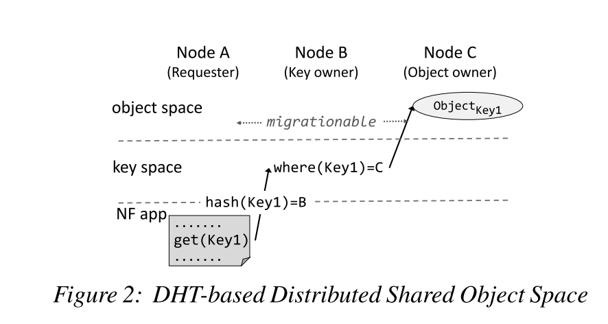
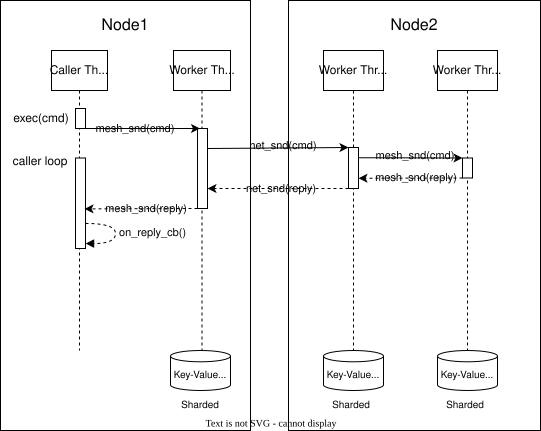

# Design

> Don't communicate by sharing memory; share memory by communicating. (Rob Pike)

I list design choices here.

Following are terminologies used in Swarm KV.

| Name      | Explained                                                    |
| --------- | ------------------------------------------------------------ |
| KV        | Key-value pair                                               |
| Node      | Instances in a Swarm KV cluster. A swarmkv node is identified with its IP, P2P port and UUID. |
| Slot      | Keyspace are partitioned in 16384 slots.  Each slot is maintained by one node. |
| Key Owner | A key ONLY has one owner.                                    |
| Replica   | A CRDT object is replicated in many nodes, which are replicas. |
| RPC       | Remote Procedure Call, used for sending command and receiving reply. |

## DHT-based KV spaces

Key-value pairs are distributed over nodes. As shown in the following picture, the key layer keeps track of the current location of every key-value pair, and the value layer stores the actual binary of key-value. This design is inspired by the NSDI'18 paper [*Elastic scaling of stateful network functions*](https://www.usenix.org/conference/nsdi18/presentation/woo).



As shown in the above picture, a KV operation is done by following steps:

1. Node A (requester) hash(key) to slot id, lookup (slot id) in the key routing table and get the key owner, which is Node B, and then send routing request to Node B.
2. The Node B (key owner) lookup (key) in the value routing table to get the object owner, which is Node C, and then a response is sent to node A.
   - if the key does not exist, the object is assigned to Node A and added to the object routing table.
3. Node A sends KV operation request to Node C.

The keyspace consistency is based on [consul](https://www.consul.io/) and its [Raft](https://raft.github.io/) implementation. As [a typical raft cluster goes up to 7 nodes](https://stackoverflow.com/questions/42422111/raft-nodes-count), so only consul server nodes participate in Raft. The consul and its [Gossip protocol](https://en.wikipedia.org/wiki/Gossip_protocol) implementation are used  to track node health.

### Global key slot table

The global slot table is stored in Consul KV, the key is swarmkv/<cluster_name>/slot_table:

```
curl http://localhost:8500/v1/kv/swarmkv/<cluster_name>/slot_table?raw=true
```

The command returns a JSON array.

```json
[
	{
		"slot": "0-1022",
		"owner": "192.168.0.1:5210"
	},
	{
		"slot": "1023",
		"owner": "192.168.0.1:5211"
	}
]
```

### Cluster leader election

The slot table is maintained by the cluster leader, which is elected from cluster peers. SwarmKV uses [Consul for leader election](https://learn.hashicorp.com/tutorials/consul/application-leader-elections). 

```
curl http://localhost:8500/v1/kv/swarmkv/<cluster_name>/lead?raw=true
```

```json
{
    "node":"192.168.0.1:5210",
    "node_uuid": "0a8ce868-6b92-449a-a44c-7f5f476236c2"
}
```

Except for node in dry run mode, cluster nodes will watch leadership changes and [run for it](https://learn.hashicorp.com/tutorials/consul/application-leader-elections) when no cluster leader.

1. Watch `swarmkv/<cluster_name>/lead` with [blocking query](https://www.consul.io/api/features/blocking).
2. If there is no session in the result, then run for leader with following steps
   - [Create a session](https://www.consul.io/api-docs/session#create-session).
   - [Update](https://www.consul.io/api-docs/kv#acquire) swarmkv/<cluster_name>/lead with `?acquire=<session>` parameter.
   - If the response is `true`, the node is elected to be a leader.
3. Go to  step 1.

### Hash tags

Like [Redis Cluster](https://redis.io/docs/reference/cluster-spec/), SwarmKV implements hash tags, which can be used to ensure that multiple keys are allocated in the same hash slot for managed by the same key owner. Note that the hash tags does not guarrantee objects are managed by the same object owner. If the key contains a "{...}" pattern only the substring between `{` and `}` is hashed in order to obtain the hash slot. However since it is possible that there are multiple occurrences of `{` or `}` the algorithm is well specified by the following rules:

- IF the key contains a `{` character.
- AND IF there is a `}` character to the right of `{`.
- AND IF there are one or more characters between the first occurrence of `{` and the first occurrence of `}`.

Then instead of hashing the key, only what is between the first occurrence of `{` and the following first occurrence of `}` is hashed.

Examples:

- The two keys `{user1000}.following` and `{user1000}.followers` will hash to the same hash slot since only the substring `user1000` will be hashed in order to compute the hash slot.
- For the key `foo{}{bar}` the whole key will be hashed as usually since the first occurrence of `{` is followed by `}` on the right without characters in the middle.
- For the key `foo{{bar}}zap` the substring `{bar` will be hashed, because it is the substring between the first occurrence of `{` and the first occurrence of `}` on its right.
- For the key `foo{bar}{zap}` the substring `bar` will be hashed, since the algorithm stops at the first valid or invalid (without bytes inside) match of `{` and `}`.
- What follows from the algorithm is that if the key starts with `{}`, it is guaranteed to be hashed as a whole. This is useful when using binary data as key names.

### Keyspace reorganization

The keyspace is sharding to slots and each slot is owned by one node. This information is recorded in the global shared slot table. If any node's health check failed, the cluster leader will choose a randome health node as the new slot owner.

You can use `CLUSTER ADDSLOTOWNER` to add node to the slot table.

When adding a new node, the operation is **Assign slot_id from `original_node`  to `new_node`**, the  `swarmkv-cli` executes the following commands:

- `KEYSPACE SETSLOT new_node_ip:port <slot_id> IMPORTING original_node_ip:port` 
  - The command sets the <slot_id> of new_node to IMPORTING state.
  - When a slot is set as IMPORTING, the node will accept all keyspace queries that are about this hash slot.

- `KEYSPACE SETSLOT original_node_ip:port <slot_id> MIGRATING new_node_ip:port` 
  - The command sets the <slot_id> of old_node to MIGRATING state.
  - When a slot is set as MIGRATING, the node will accept all queries that are about this hash slot, but only if the key in question exists, otherwise the query is forwarded using a -ASK redirection to the node that is target of the migration.

- `KEYSPACE GETKEYSINSLOT original_node_ip:port <slot_id>`
  - The command gets a blob of all key entries of <slot_id> from the original_node

- `KEYSPACE ADDKEYSTOSLOT new_node_ip:port <slot_id> blob_of_getkeysinslot  `
  - The command adds all key entries to the <slot_id> of new_node.

- `KEYSPACE DELSLOTKEYS original_node_ip:port <slot_id>`
  - The command erases all key entries of the <slot_id> of the original_node.


After all desired slots are migrated, the `swarmkv-cli` updates the global slot table in Consul.

Known issues:

- Deleting existing keys and adding replica to existing keys between the `getkeysinslot` and `delslotkeys` could not take effect on the new node. It's better to execute `CLUSTER SANITY heal` after the migration.

- What if someone nodes are failed during the migration? [Todo] `swarmkv-cli` acquires the cluster leadership before the migration.

  - If the new node fails, the original node still owns slot k, and after a timeout without receiving slot table update, it will restore it to a stable state.

  - If the original node fails, the new node aborts this migration and waits for the cluster leader to update the global slot table.

  - If other nodes fail, the cluster leader will receive destination node's notification and update the slot table.


## KV Operation

When a requestor executes a command, it takes the following steps

- Local Execution
  - For key exists in local store, commands are executed locally, except for commands modify keyspace.
- Key Route
  - The requestor hash the key to slot id to find out the key owner.
  - The requestor send  `KEYSPACE RADD/RLIST/DEL` command to the key owner.
- The key owner processes the keyspace command and return the addresses of all replica.
- The requestor receives the key owner's reply, it will
  - Create local replica
  - Send the command to the one of the replica
  - Send `CRDT PULL key` command to some of the replicas

- Other replica executes the command, registers the requestor as one of the replica nodes, and send a reply to the requestor
- The requestor receives the reply and invokes user callback function.


## Fault tolerance

### High availability

Keyspace replication is not implemented yet.

### Health check

Each node registers an HTTP service to the Consul, and the local Consul agent checks node health periodically via HTTP GET.
If a node fails, the cluster leader gets notification and removes the failed node by reassigning its slots to other nodes.

## Wire protocol

Messages between nodes is start with a fixed length header and a variable length payload. The payload is serialized with [MessagePack](https://msgpack.org/index.html) format. For readability, we use JSON to describe the request and response here.

Take the following command as an example:

```json
[
  "HMGET",
  "zhangsan's information",
  "phone number",
  "address",
  "avatar"
]
```

Reply message

```json
{
  "reply_type": "elements",
  "element": [
    {
      "reply_type": "string",
      "string": "+86 186 0000 0000"
    },
    {
      "reply_type": "string",
      "string": "House 01, Haidian District, Beijing, China"
    },
    {
      "reply_type": "string",
      "string": "0c 74 65 78 74 20 20 20 20 43 6f 70 79 72 69 67 68 74 20 28 63 29 20 31 39 39 38 20 48 65 77 6c 65 74 74 2d 50 61 63 6b 61 72 64 20 43 6f 6d 70 61 6e 79 20 20 64 65 73 63 20 20 20 20 20 20 20 12 73 52 47 42 20 49 45 43 36 31 39 36 36 2d 32 2e 31 20 20 20 20 20 20 20 20 20 20 20 12 73 52 47 42 20 49 45 43 36 31 39 36 36 2d 32 2e 31 20 20 00"
    }
  ]
}
```
The MessagePack payload is then compressed using [Snappy](https://github.com/google/snappy) for network transmission. The following table shows the message size before and after compression.

| Test Case                           | Uncompressed | Snappy       |
| ----------------------------------- | ------------ | ------------ |
| SwarmkvTwoNodes.TypeFairTokenBucket | 1849.5 bytes | 316.3 bytes  |
| SwarmkvTwoNodes.TypeBulkTokenBucket | 131076 bytes | 8975.5 bytes |

## Node design

### Lock Design
The swarmkv node adopts a share-nothing design to maximize multithread scalability. The three data modules are:
- Store Module: This module stores actual CRDT objects. The number of key-CRDT hash tables is equal to the number of worker threads, with each worker thread accessing its own designated hash table in a lock-free manner.
- Keyspace Module: This module stores the replica addresses of keys. It features a key-route hash table with 16,384 slots. A worker thread can only access its designated slots. The access by worker threads to the key-route hash table is lock-free.
- Monitor Module: This module collects performance metrics for diagnostics. It achieves lock-freedom by utilizing [HdrHistogram_c](https://github.com/HdrHistogram/HdrHistogram_c)'s interval recorder.

If a thread needs to access data from other threads, it sends a message via a mesh (ringbuf) to the target thread. The mesh is lock-free.

### Thread model
There two thread types in a swarmkv node:
- The Caller thread is the thread that calls the swarmkv API.
- The Worker thread is the thread that runs the event loop and processes commands.

A swarmkv instance has configurable worker threads. Swarmkv uses [libevent](https://github.com/libevent/libevent) for peer-to-peer communication and run event loop. 
Each worker thread reads and writes its own shard of KV store and Keyspace table. If a worker thread receives a command for a key that is not in its shard, it will forward the command with mesh (ringbuf) to the worker thread that owns the key. If a worker thread receives a command targeted to a remote node, this is most likely from the caller thread, it will forward with network.

 

All worker threads are responsible for:
- Watch global slot table changes.
- Run periodic tasks. 
- Send command message, which is from swarmkv API caller to destination peers.
- Receive KV command message, and then process it based on command type:
  - Key routing request (from the requester, object reader/writer): lookup the object owner, and then send key routing response.
  - Object operation request (from the requester): lookup the object, perform the operation and then send object operation response.
  - Key routing response (from the key owner): send the request to the object owner.
  - Object operation response (from object owner): update local cache, and invoke the user-specified callback.
- For multi-thread scalability, each worker thread maintains connections to all active peers. It's possible that there are one or more connections between two nodes.

The worker thread 0 has extra tasks including:

- Accepting TCP connections from other peers. It begins by peeking at the message header to determine the caller thread ID, then it load balances the connection across worker threads using the caller_ID mod worker thread number. This mechanism eliminates unnecessary inter-thread communication for nodes with the same worker thread number.
- Watch leadership changes, and run for leader if cluster loses its leader.
- For leader node:
  - Watch cluster health check, remove failed node from cluster by assigning its slots to other nodes.

## Source Code layout

The source files are organized as follows:

- src/swarmkv.c event loop, orchestration
- src/swarmkv_api.c API implementaions.
- src/swarmkv_store.c  KV operations, key hash table is implemented with [uthash](https://troydhanson.github.io/uthash/). Use [sds](https://github.com/antirez/sds) as a dynamic string library.
- src/swarmkv_sync.c batching CRDT syncronization.
- src/swarmkv_keyspace.c: The control plane of SwarmKV. Interact with [HashiCorp Consul](https://www.consul.io/) for node discovery, slot assignment, and leader election.
- src/swarmkv_message.c: Message is encoded to [MessagePack](https://msgpack.org/index.html) format by [mpack](https://github.com/ludocode/mpack) library.
- src/swarmkv_mesh.c: Lock-free inter-threads communication via [ringbuf](https://github.com/rmind/ringbuf)
- src/swarmkv_net.c: High performance P2P communication via [libevent](https://libevent.org/).
- src/swarmkv_rpc.c: Remote procedure call (Command -> Reply) implementation.
- src/swarmkv_monitor.c Collecting performance metrics.
- src/t_xxx.c Implementing SwarmKV commands of various data types.
- src/deps/ Dependencies in source codes format, such as [uthash](https://troydhanson.github.io/uthash/), [sds](https://github.com/antirez/sds), [mpack](https://github.com/ludocode/mpack), [timeout](https://25thandclement.com/~william/projects/timeout.c.html), [cJSON](https://github.com/DaveGamble/cJSON), [HDRHistogram](https://github.com/HdrHistogram/HdrHistogram_c).
- src/vendor/  Dependencies in archive format.
- CRDT/ Implementing Conflict-free replicated data types.
- test/ Unit tests.
- tools/swarmkv_cli: CLI implementation which is facilitated by [linenoise](https://github.com/antirez/linenoise).

# Similar projects

[dqlite](https://dqlite.io/) is a C library that implements an embeddable and replicated SQL database engine with high availability and automatic failover.

[rqlite](https://github.com/rqlite/rqlite) is an easy-to-use, lightweight, distributed relational database, which uses [SQLite](https://www.sqlite.org/) as its storage engine. 

[Zeppelin](https://github.com/Qihoo360/zeppelin) is a Distributed Key-Value Platform that aims to provide excellent performance, reliability, and scalability.

[Couchbase](https://www.couchbase.com/) is a distributed, elastic, in-memory database on your cloud and at your edge.

[Apache Geode](http://geode.apache.org/) is a data management platform (JAVA) that provides real-time, consistent access to data-intensive applications throughout widely distributed cloud architectures. 

[Apache Ignite](https://ignite.apache.org/) is a distributed database for high-performance computing with in-memory speed.

[Tarantool](https://www.tarantool.io/en/) is an in-memory computing platform consisting of a database and an application server.

[eXtremeDB](https://www.mcobject.com/) is a hybrid persistent and in-memory database management system for edge and cloud. It's a commercial software and close source.

[vedis](https://vedis.symisc.net/)  is an embeddable datastore C library built with over 70 commands similar in concept to Redis but without the networking layer since Vedis run in the same process of the host application.

[UnQLite](https://github.com/symisc/unqlite) is a in-process software library which implements a self-contained, serverless, zero-configuration, transactional NoSQL database engine. 

[OrbitDB](https://github.com/orbitdb/orbit-db) is a serverless, distributed, peer-to-peer database. OrbitDB uses [IPFS](https://ipfs.io/) as its data storage and [IPFS Pubsub](https://github.com/ipfs/go-ipfs/blob/master/core/commands/pubsub.go#L23) to automatically sync databases with peers. It's implemented in JavaScript.

[Dynomite](https://github.com/Netflix/dynomite), inspired by Dynamo whitepaper, is a thin, distributed dynamo layer for different storage engines and protocols. Currently these include Redis and Memcached. Dynomite supports multi-datacenter replication and is designed for high availability.

[AntidoteDB](https://www.antidotedb.eu/) is a planet scale, highly available, transactional database. It's implemented in Erlang. Research paper: [Cure: Strong semantics meets high availability and low latency](https://hal.inria.fr/hal-01270776v2/document).

[EdgeDB](https://github.com/edgedb/edgedb) is a new kind of database that takes the best parts of relational databases, graph databases, and ORMs. We call it a graph-relational database.

[SwarmDB](https://github.com/gritzko/swarm) is a proof-of-concept key-value RON store.

[Voldemort](https://github.com/voldemort/voldemort) is a distributed key-value storage system.

[Corfu](https://github.com/CorfuDB/CorfuDB) is a consistency platform designed around the abstraction of a shared log.

[Riak KV](https://riak.com/index.html) is a distributed NoSQL key-value database with advanced local and multi-cluster replication that guarantees reads and writes even in the event of hardware failures or network partitions.

# References

Woo, Shinae, et al. "Elastic scaling of stateful network functions." *15th {USENIX} Symposium on Networked Systems Design and Implementation ({NSDI} 18)*. 2018. [Source] (https://www.usenix.org/conference/nsdi18/presentation/woo)

[Redis Cluster Specification](https://redis.io/topics/cluster-spec)

[C implementation of the Raft consensus protocol](https://github.com/willemt/raft) by Willem-Hendrik Thiart.
