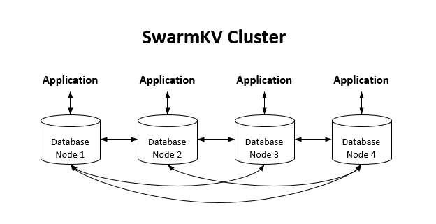

<h1>
  
  <span>SwarmKV</span>
</h1>


**SwarmKV is a embedded and distributed key-CRDT store with peer-to-peer networking .** 

Main Features

- Cluster
- State-based CRDT syncronization
- Strong Eventual Consistency (in the language of [CAP](https://en.wikipedia.org/wiki/CAP_theorem), this system prioritizes availability and partition tolerance).

**Why not Redis?** Because SwarmKV is

- Embedded, **no** additional servers.
- [CRDT](https://en.wikipedia.org/wiki/Conflict-free_replicated_data_type) native
- Scalable for trillions of operations per second, billions of keys, and thousands of parallel operators

**Why not SQLite, rqlite, or dqlite?** Because Swarm KV is not designed to be a relational database and extremely fast.

 

SwarmKV Data Types

- String
- Integer
- Set
- Hash Table
- Bitmap [todo]
- Token Bucket


# Getting started

## Building SwarmKV

Download and unzip swarmkv-xx.zip

- Build swarmkv from source code (requires cmake version > 3.5)

  - `mkdir swarmkv-xxx/build`
  - `cd swarmkv-xxx/build`
  - `cmake .. -DCMAKE_BUILD_TYPE=Debug`
  - `make`

## Run Hashicorp Consul

SwarmKV uses [HashiCorp Consul](https://www.consul.io/) for cluster management, which includes leader election, health checking, and slot table management. You can download Hashicorp Consul from https://developer.hashicorp.com/consul/downloads.

Then, run consul agent in debug mode. If you are not familiar with Consul, there is a consul configuration file in swarmkv source directory, copy it to somewhere you desire.

- Edit `./swarmkv/test/consul.d/server.hcl` and set the `bind_addr ` as you need

- `./consul agent -dev -config-dir=./swarmkv/test/consul.d/`

Check consul UI via http://localhost:8500/ui

## Create Cluster

Create swarmkv cluster with `swarmkv-xxx/build/tools/swarmkv-cli`

```
[zhengchao@centos7-vm-dev tools]$ ./swarmkv-cli --cluster-create swarmkv-basic-test 127.0.0.1:5210
consul KV init slot table /v1/kv/swarmkv/swarmkv-basic-test/slots.
OK
[zhengchao@centos7-vm-dev tools]$ ./swarmkv-cli --cluster-create swarmkv-2-nodes 127.0.0.1:5210 127.0.0.1:5220
consul KV init slot table /v1/kv/swarmkv/swarmkv-2-nodes/slots.
OK
```

## Run test cases
```shell
cd test/
./swarmkv_gtest
```


## Playing  with `swarmkv-cli`

```shell
[zhengchao@centos7-vm-dev tools]$ ./swarmkv-cli -n swarmkv-2-nodes
swarmkv-2-nodes> get id001
"lisi"
swarmkv-2-nodes> expire id001 60
(integer) 1
swarmkv-2-nodes>
```

## C API

The following example is two nodes (db[0] and db[1]) communicating via SwarmKV.

```c
#include "swarmkv/swarmkv.h"
#include "stdio.h"
#include "stdlib.h"

int main(int argc, char **argv)
{
    struct swarmkv_options *opts[2];
    struct swarmkv *db[2];
    char *err=NULL;
    const char *cluster_name="simple-example";
    for(size_t i=0; i<2; i++)
    {
        opts[i]=swarmkv_options_new();
        swarmkv_options_set_cluster_port(opts[i], 5210+i);
        db[i]=swarmkv_open(opts[i], cluster_name, &err);
        if(err)
        {
            printf("swarmkv_open failed: %s.\n", err);
            free(err);
            return -1;
        }
    }
    const char *key="name";
    const char *value="zhangsan";
    struct swarmkv_reply *reply=NULL;
    reply=swarmkv_command(db[0], "set %s %s", key, value);
    swarmkv_reply_free(reply);
    reply=swarmkv_command(db[1], "get %s", key);
    if(reply->type==SWARMKV_REPLY_STRING)
    {
        printf("get name: %s\n", reply->str);
    }
    else
    {
        printf("get name failed, reply type: %d, str: %s\n",
                    reply->type, reply->str);
    }
    swarmkv_reply_free(reply);
    for(size_t i=0; i<2; i++)
    {
	    swarmkv_close(db[i]);
    }
    return 0;
}
```


# Further documentation

Here are some specific details about the SwarmKV.
* [Commands](./docs/commands.md)
* [Design](./docs/design.md)
* [CLI](./docs/cli.md)