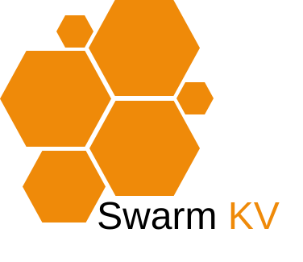
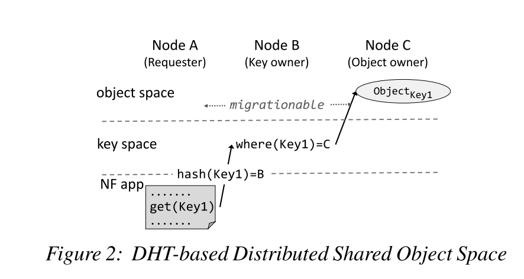

<h1>
  
  <span>SwarmKV</span>
</h1>

**SwarmKV is a embedded and distributed key-value storage library with peer-to-peer networking.** 
SwarmKV uses [HashiCorp Consul](https://www.consul.io/) for cluster management, which includes leader election, health checking, and slot table management.

**Main Features**

- High availability (in the language of [CAP](https://en.wikipedia.org/wiki/CAP_theorem), this system prioritizes availability and partition tolerance).

**Why not Redis?** Because Swarm KV is

- Embedded, **no** additional servers.
- Cache optimized
- Salable for trillions of operations per second, billions of keys, and thousands of parallel operators

**Why not SQLite, or rqlite, dqlite?** Because Swarm KV is not a relational database and is extremely fast.

Following are terminologies used in Swarm KV.

Vocabularies

| Name        | Explaination                                                 |
| ----------- | ------------------------------------------------------------ |
| KV          | Key-value pair                                               |
| Node        | Instances in a Swarm KV cluster. A swarmkv node is identified with its IP, P2P port and UUID. |
| Slot        | KVs are partitioned in different slots, and keys of one table are scattered in many slots.  Each slot is maintained by one node. |
| Transaction | A command and its reply.                                     |

SwarmKV Data Types

- String
- Integer
- Hash Table
- Rate limiter

SwarmKV operations

- Get, Set, Delete
- TTL

| Command Operator  | Command Args           | Response                                                     |
| ----------------- | ---------------------- | ------------------------------------------------------------ |
| GET               | key                    |                                                              |
| SET               | key value              |                                                              |
| DEL               | key                    |                                                              |
| HGET              |                        |                                                              |
| CLUSTER OBJ_OWNER | key                    | 1) "192.168.1.200"<br/>2) (integer) 5211                     |
| SYNC              | key_version origin_cmd | status reply, "OK" or "out of sync". The "out of sync" reply triggers a new sync cmd which wraps a set cmd. |


# SwarmKV Design

I list design choices here.

Todo: 

- Object migration
- Nodes failover by object replication

## DHT-based KV spaces

Key-value pairs are distributed over nodes. As shown in the following picture, the key layer keeps track of the current location of every key-value pair, and the value layer stores the actual binary of key-value. This design is inspired by the NSDI'18 paper [*Elastic scaling of stateful network functions*](https://www.usenix.org/conference/nsdi18/presentation/woo).



As shown in the above picture, a KV operation is done by following steps:

1. Node A (requester) hash(key) to slot id, lookup (slot id) in the key routing table and get the key owner, which is Node B, and then send routing request to Node B.
2. The Node B (key owner) lookup (key) in the value routing table to get the object owner, which is Node C, and then a response is sent to node A.
   - if the key does not exist, the object is assigned to Node A and added to the object routing table.
3. Node A sends KV operation request to Node C.

The keyspace consistency is based on [consul](https://www.consul.io/) and its [Raft](https://raft.github.io/) implementation. As [a typical raft cluster goes up to 7 nodes](https://stackoverflow.com/questions/42422111/raft-nodes-count), so only consul server nodes participate in Raft. The consul and its [Gossip protocol](https://en.wikipedia.org/wiki/Gossip_protocol) implementation are used  to track node health.

### Global Slot Table

The global slot table is stored in Consul KV, the key is swarmkv/<cluster_name>/slot_table:

```
curl http://localhost:8500/v1/kv/swarmkv/<cluster_name>/slot_table?raw=true
```

The command returns a JSON array.

```json
[
	{
		"slot": "0-1022",
		"owner": {
			"ip": "192.168.0.1",
			"p2p_port": 35210,
			"node_id": "921e25e4-85a4-11ec-a8a3-0242ac120002"
		},
		"replicas": [
			{
				"ip": "192.168.0.2",
				"p2p_port": 35210,
				"node_id": "ebe5a57c-cb33-4b2f-968f-44c4b87ea8d9"
			},
			{
				"ip": "192.168.0.3",
				"p2p_port": 35210,
				"node_id": "a8ba5a68-65bd-4168-af15-1ddee7ecf5cd"
			}
		]
	},
	{
		"slot": "1023",
		"owner": {
			"ip": "192.168.0.2",
			"p2p_port": 35210,
			"node_id": "ebe5a57c-cb33-4b2f-968f-44c4b87ea8d9"
		},
		"replicas": [
			{
				"ip": "192.168.0.1",
				"p2p_port": 35210,
				"node_id": "921e25e4-85a4-11ec-a8a3-0242ac120002"
			}
		]
	}
]
```

### Cluster Leader Election

The slot table is maintained by the cluster leader, which is elected from cluster peers. SwarmKV uses [Consul for leader election](https://learn.hashicorp.com/tutorials/consul/application-leader-elections). 

```
curl http://localhost:8500/v1/kv/swarmkv/<cluster_name>/lead?raw=true
```

```json
{
    "ip":"192.168.0.1",
    "p2p_port": 35210
}
```

Except for node in dry run mode, cluster nodes will watch leadership changes and [run for it](https://learn.hashicorp.com/tutorials/consul/application-leader-elections) when no cluster leader.

1. Read `swarmkv/<cluster_name>/lead` with [blocking query](https://www.consul.io/api/features/blocking).
2. If there is no session in the result, then run for leader with following steps
   - [Create a session](https://www.consul.io/api-docs/session#create-session).
   - [Update](https://www.consul.io/api-docs/kv#acquire) swarmkv/<cluster_name>/lead with `?acquire=<session>` parameter.
   - If the response is `true`, the node is elected to be a leader.
3. Go to  step 1.

### Keyspace reorganization

The keyspace is sharding to slots and each slot is owned by one node. This information is recorded in the global shared slot table, which is maintained by the cluster leader.

When adding a new node, the operation is **Move slot N from node A to node B**,  it has the following steps:

- Cluster leader sends move command to node B
- Node B sends MIGRATE command to node A and sets local slot N to IMPORTING
- Node A sets local slot N to MIGRATING and sends key owner mapping to node B. During which:
  - When a slot is set as MIGRATING, the node will accept all queries that are about this hash slot, but only if the key in question exists, otherwise the query is forwarded using a -ASK redirection to the node that is target of the migration.
  - When a slot is set as IMPORTING, the node will accept all queries that are about this hash slot, but only if the request is preceded by an ASKING command. If the ASKING command was not given by the client, the query is redirected to the real hash slot owner via a -MOVED redirection error, as would happen normally.
- After the migration, node A sets slot N's owner to node B. 
- Node B notifies the cluster leader that slot N is migrated to node B.
- Cluster leader append slot assignment operation to other server nodes (Raft Protocol), and broadcast the slot operation to the entire cluster.

What if someone fails during the migration?

- If the cluster leader fails, the new leader will receive node B's notification and update the slot table.
- If node B fails, node A still owns slot N, and after a timeout without receiving slot table update, it will restore it to a stable state.
- if node A fails, node B aborts this migration and waits for the cluster leader to update the global slot table.

When a master node A fails, if slots owned by A has a replica which is node B, the cluster leader will promote node B to slot owner. It has the following steps:

- Cluster leader sends promote command to 

,  in which,  N is slot id, Y contains a 32-bit node ID, UUID format version, IP and port. 

## Cache Model

The swarmkv's cache model is inspired by [Redis server-assisted client side caching](https://redis.io/topics/client-side-caching). The object owner remembers what keys a given peer accessed, and sends update messages when the same keys are modified.  


## KV Operation

When a requester executes a command, it takes the following steps

- for a read operation, lookup local cache, if a cache miss or a write operation
- the requester lookup global keyspace to find out the key owner, and send the command message to the key owner
- the key owner lookup key route table,
  - if no key entry exists
    - if it's a  read operation, return NULL
    - if it's a write operation, register the requester as the object owner
  - if the key entry exists, send the object owner node address to the requester
- the requester receives the key owner's reply, send the command to the object owner
- the object owner executes the command, registers the requester as one of the cache tracking nodes, and send a reply to the requester
- the requester receives the reply and invokes  call back function

## Fault Tolerance

### High Availability

Each object has *N* replicas. Those replicas are managed by the key owner and key owner replica.

### Health Check

Nodes use a gossip protocol to send ping packets to make sure all the other nodes are working properly.  A node flags another node with the `PFAIL` flag when the node is not reachable for more than `NODE_TIMEOUT` time. Every node sends gossip messages to every other node including the state of a few random known nodes. Every node eventually receives a set of node flags for every other node. This way every node has a mechanism to signal other nodes about failure conditions they have detected.

### Handle key owner fails

If a node is failed, peers will detect it by not replying ping message

## Wire Protocol

Messages between nodes is start with a fixed length header and a variable length payload. The payload is serialized with [MessagePack](https://msgpack.org/index.html) format.  For readability, we use JSON to describe the request and response here.

Command message

```json
{
    "msg_type":"cmd",
    "do_not_reply": false,
    "txn_seq": 7237914459,
    "txn_initiator": "ebe5a57c-cb33-4b2f-968f-44c4b87ea8d9",
    "cmd":{
        "op":"HMGET",
        "args":[
            "user1",
            "phone_number",
            "address",
            "avatar"
        ]
    }
}
```

Reply message

```json
{
	"msg_type":"reply",
    "txn_seq": 7237914459,
    "txn_initiator": "ebe5a57c-cb33-4b2f-968f-44c4b87ea8d9",
    "reply":{
        "reply_type":"array",
        "element":[
            {
                "reply_type":"string",
                "string": "+86 186 0000 0000"
            },
            {
                "reply_type":"string",
                "string":"House 01, Haidian District, Beijing, China"
            },
            {
                "reply_type":"string",
                "string":"0c 74 65 78 74 20 20 20 20 43 6f 70 79 72 69 67 68 74 20 28 63 29 20 31 39 39 38 20 48 65 77 6c 65 74 74 2d 50 61 63 6b 61 72 64 20 43 6f 6d 70 61 6e 79 20 20 64 65 73 63 20 20 20 20 20 20 20 12 73 52 47 42 20 49 45 43 36 31 39 36 36 2d 32 2e 31 20 20 20 20 20 20 20 20 20 20 20 12 73 52 47 42 20 49 45 43 36 31 39 36 36 2d 32 2e 31 20 20 00"
            }
        ]
    }
}
```

Cache synchronization message

```json
{
	"msg_type":"sync",
	"txn_seq": 7237914460,
    "txn_initiator": "ebe5a57c-cb33-4b2f-968f-44c4b87ea8d9",
    "object_version":101,
    "cmd":{
        "op":"HMSET",
        "args":[
            "user1",
            "phone_number",
            "+86 186 0000 0000"
        ]       
    }
}
```


## Node Design

### Thread Model

A swarmkv instance has one main thread and several (configurable) work threads. Swarmkv uses [libevent](https://github.com/libevent/libevent) as a peer-to-peer communication infrastructure.  The main thread is responsible for:

- Accept TCP connections from new peers, and then load balance new peers to worker threads. 
  - Only This is the main reason for having a 'main' thread.
- Generate ping message periodically, and then let the worker thread which processes the destination peer to send the ping message.

The worker threads are responsible for:

- Send KV command message, which is from swarmkv API caller to destination peers.
- Receive KV command message, and then process it  based on message type:
  - Key routing request (from the requester, object reader/writer): lookup the value owner, and then send key routing response.
  - Object operation request (from the requester): lookup the value, perform the operation and then send value operation response.
  - Key routing response (from the key owner): send the request to the decoded value owner.
  - Object operation response (from object owner): update local cache, and invoke the user-specified callback.
- Receive control message, and then process it based on message type:
  - Ping message:  send a pong message which a has key routing table and node list
  - Pong message: update key routing table and node list
  - Meet message: ?

## Source Code Directory Structure

The source files are organized as follows:

- swarmkv.c event loop, orchestration
- swarmkv_store.c  kv operation, key hash table is implemented with [uthash](https://troydhanson.github.io/uthash/). Use [sds](https://github.com/antirez/sds) as dynamic string library.
- swarmkv_keyspace.c: The control plane of SwarmKV. Interact with [HashiCorp Consul](https://www.consul.io/) for node discovery, slot assignment, and leader election.
  - The keyspace is partitioned by key slots among the participating nodes. 
- swarmkv_message.c: Message is encoded to [MessagePack](https://msgpack.org/index.html) format by [mpack](https://github.com/ludocode/mpack) library.
- swarmkv_net.c: High performance P2P communication via [libevent](https://libevent.org/).

## Similar Projects

[dqlite](https://dqlite.io/) is a C library that implements an embeddable and replicated SQL database engine with high availability and automatic failover.

*[rqlite](https://github.com/rqlite/rqlite)* is an easy-to-use, lightweight, distributed relational database, which uses [SQLite](https://www.sqlite.org/) as its storage engine. 

[Zeppelin](https://github.com/Qihoo360/zeppelin) is a Distributed Key-Value Platform that aims to provide excellent performance, reliability, and scalability.

[Couchbase](https://www.couchbase.com/) Have a distributed, elastic, in-memory database on your cloud and at your edge.

[Apache Geode](http://geode.apache.org/) is a data management platform (JAVA) that provides real-time, consistent access to data-intensive applications throughout widely distributed cloud architectures. 

[Apache Ignite](https://ignite.apache.org/) is a distributed database for high-performance computing with in-memory speed.

## References

Woo, Shinae, et al. "Elastic scaling of stateful network functions." *15th {USENIX} Symposium on Networked Systems Design and Implementation ({NSDI} 18)*. 2018.

[C implementation of the Raft consensus protocol](https://github.com/willemt/raft) by Willem-Hendrik Thiart.

[Redis Cluster Specification](https://redis.io/topics/cluster-spec)


